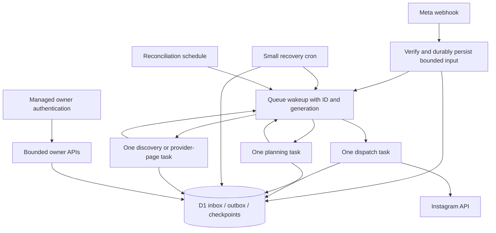

# FadeLoop: investigation of Cloudflare Free CPU-limit failures

Date: 16 October 2026. Scope: the current local working tree, including the pre-existing edits to `src/index.ts` and `wrangler.toml`.

## Decision

**The current architecture does not provide a credible under-10-ms CPU bound.** It limits elapsed time and SQL work, but still performs ingestion, recovery, planning, sending and finalization within the same invocation. Password hashing is a separate expensive path. More incoming events and larger account history increase the work those invocations perform.

My recommendation, if staying on Free and targeting under 10 ms is mandatory, is:

**Keep D1 as the durable source of truth; process small, separately invoked ingestion, planning, sending and reconciliation tasks through Cloudflare Queues; move owner password hashing to managed authentication.** Preserve the existing send ownership, connection generations, conversation versions and uncertainty rules. This is a targeted redesign of execution boundaries, not a replacement of the automation engine's business rules.

This recommendation is feasible with the existing inbox, outbox and checkpoints. It is **not yet a measured promise that every proposed stage fits 10 ms**. Stage size must be set from deployed CPU measurements, with an explicit workload envelope and headroom. No implementation should claim success merely because an average falls below 10 ms.

If preserving the current password login and minimizing engineering work take precedence, Workers Paid is the practical alternative. That removes the immediate 10-ms restriction, but does not fix the correctness and growth defects identified below.

## 1. What the incident evidence establishes

The owner supplied these observations during this investigation:

- Cloudflare emailed that the account exceeded the Free CPU limit **at least 1,000 times in the preceding 24 hours**.
- The Cloudflare Worker listing displays **42 ms average CPU** for the project.
- The owner does not yet have route-level CPU distributions or error attribution.

These are recurring resource-limit failures, not just concern about possible future scale. However, the email is account-wide. It does not establish that all 1,000 failures belong to this Worker, or which paths caused them. The listing average does not distinguish webhooks, scheduled work, owner login and dashboard APIs.

Reducing 42 ms to below 10 ms would require more than a **76.2% reduction** for the same workload mix. Reducing work per invocation by splitting it changes that mix; it can meet the per-invocation constraint without reducing total CPU by the same percentage. Both total work and per-invocation CPU need monitoring.

### Verified platform rules

Cloudflare documents **10 ms CPU per HTTP request and per Cron Trigger** on Workers Free. Network and database waiting are excluded. JSON processing, application execution and runtime work around I/O still matter. Consistent overuse can terminate execution; `exceededCpu` is the relevant invocation outcome. Occasional above-limit successes are not a dependable allowance. [Workers limits](https://developers.cloudflare.com/workers/platform/limits/)

`ctx.waitUntil()` extends the lifetime of the existing invocation after the response. It does not create a separate scheduled task or a new CPU allowance. Consequently, acknowledging a webhook and then draining jobs through `waitUntil()` still leaves those operations in that webhook's execution. [Execution context](https://developers.cloudflare.com/workers/runtime-apis/context/)

Cloudflare's CPU chart uses sampled quantiles and can show above-limit results because of rollover allowances. Therefore, inspect distributions and outcomes instead of treating an above-limit success as evidence of compatibility. [Workers metrics](https://developers.cloudflare.com/workers/observability/metrics-and-analytics/)

### Critical attribution clue: invocation count

The local configuration currently schedules reconciliation every 15 minutes and refresh once daily: approximately **97 scheduled invocations/day**. Those triggers alone cannot explain 1,000 distinct failures/day under this exact configuration. HTTP traffic, other Workers, or a different deployed configuration must also be involved.

The checked-in configuration before the owner's current edits used a minute trigger: approximately **1,441 scheduled invocations/day**. That older cadence could produce 1,000 failing scheduled invocations. I have not verified which version was deployed during the email's reporting window. This distinction must be resolved before assigning the incident to one route.

Evidence: [wrangler.toml:23](../wrangler.toml#L23), the existing working-tree diff, and [src/index.ts:44](../src/index.ts#L44).

## 2. Investigation method and its limits

I inspected every authored backend module under `src/`, the schema migrations, the build/deployment settings, frontend API fetch behavior, existing benchmarks and relevant tests. The generated Argon2 adapter was inspected for its import/build path; its upstream cryptographic algorithm was not independently audited.

I added an investigation-only harness: [scripts/audit-cpu-operations.mjs](../scripts/audit-cpu-operations.mjs). It bundles the current application, starts disposable workerd/D1, applies the real migrations, intercepts every provider request, and exercises real handlers. It does not load `.env`, use deployment credentials, access production D1, deploy a Worker, or send Instagram messages.

The final run covered **33 application invocations**, plus six PBKDF2 checks and six legacy Argon2 checks. Instrumentation counted raw SQL statements, D1 binding calls, connection guards, local row reads/writes and fixture response sizes. It also captured SQLite query plans and a local V8 sampling profile of password checks.

Fixtures disable send spacing and raise account/recipient limits so the workload can exercise the processing path without waiting. These fixtures reveal operation counts, not real provider throughput or production pacing behavior. Handler responses are consumed and registered background work is awaited before recording final state. Cron handlers are called by a test adapter; this validates their code paths, not production scheduler behavior.

**No number in the local timing results is Cloudflare billed CPU.** Local wall time includes the test bridge and I/O. The instrumentation itself adds work. V8 sampling intervals are attribution evidence, not an exact billable CPU meter. SQL counts demonstrate amplification and budget behavior; they do not establish that a query costs a particular number of CPU milliseconds.

A connected browser was unavailable, so I could not inspect the live Cloudflare dashboard. No production trace or route-level CPU export was available. The precise explanation of the reported 42 ms therefore remains unmeasured, even though several underlying mechanisms and two correctness defects were reproduced.

Compact evidence: [cpu-investigation-evidence.json](cpu-investigation-evidence.json). Complete SQL histograms, source hashes, bundle metadata, local times and the profile are generated under `.wrangler/cpu-investigation/`.

## 3. Measured operation counts

SQL statements include connection guards and individual batch members. D1 calls count binding round trips, so one transactional batch can contain several statements. The two counts must not be confused.

| Scenario | SQL statements | D1 calls | Guard statements | Provider reads / sends | Durable result |
| --- | ---: | ---: | ---: | ---: | --- |
| Health | 0 | 0 | 0 | 0 / 0 | Simple response |
| Invalid webhook signature | 1 | 1 | 0 | 0 / 0 | Rejected, but already read D1 |
| Valid empty webhook | 5 | 4 | 1 | 0 / 0 | Still constructs runtime and invokes drain |
| Due reconciliation, empty provider data, one active post | 33 | 19 | 10 | 2 / 0 | Poll metadata/checkpoints updated |
| One matching comment webhook | 32 | 17 | 8 | 0 / 1 | One confirmed opening |
| Six unique matching comments | 73 | 37 | 17 | 0 / 3 | Three confirmed; three events pending |
| Fifty unique matching comments | 73 | 37 | 17 | 0 / 3 | Three confirmed; 47 pending |
| One hundred unique matching comments | 73 | 37 | 17 | 0 / 3 | Three confirmed; 97 pending |
| 501 byte-identical comment copies | 32 | 17 | 8 | 0 / 1 | Existing in-page deduplication works |
| Repeat of a completed comment | 10 | 6 | 3 | 0 / 0 | No duplicate send |
| Unmatched comment | 16 | 10 | 5 | 0 / 0 | Event completed without a send |
| Ambiguous provider failure | 30 | 17 | 8 | 0 / 1 | Job becomes `unknown`, no automatic replay |
| Button leading directly to delivery | 30 | 16 | 8 | 0 / 1 | Delivery confirmed |
| Message discovery + one 50-message page, no drain | 20 | 11 | 6 | 2 / 0 | Fifty inbox events persisted |
| Five posts × 50 comments, ingestion only | 50 | 28 | 16 | 5 / 0 | 250 inbox events persisted |
| Full cron, five active posts, full provider pages | 77 | 42 | 25 | 7 / 0 | 300 events persisted; none sent in that invocation |
| Ingest 100 normalized events only | 3 | 2 | 1 | 0 / 0 | All 100 persisted |
| Runtime + one drain iteration | 27 | 14 | 6 | 0 / 1 | One event planned and one send confirmed |
| Subsequent cron with that backlog | 75 | 38 | 18 | 0 / 3 | Three additional sends |
| Owner status | 6 | 6 | 0 | 0 / 0 | Small fixture response |
| Campaign list | 2 | 2 | 0 | 0 / 0 | All campaigns returned |
| Dashboard | 2 | 2 | 0 | 0 / 0 | Aggregated result |
| Contacts | 2 | 2 | 0 | 0 / 0 | Capped list |
| Automation health | 7 | 7 | 0 | 0 / 0 | Summary and review lists |
| PBKDF2 owner login | 9 | 4 | 0 | 0 / 0 | Password verification also performed |
| Daily refresh skipped + cleanup | 6 | 2 | 0 | 0 / 0 | Tested separately from poll cron |

These measurements already falsify the idea that each webhook is just signature verification plus one database write. They also show that batching SQL does not make the surrounding invocation constant-cost: ingesting 100 events uses only three statements, but still serializes and hashes 100 distinct events in JavaScript.

## 4. Findings, ranked by relevance

| Rank | Finding | Evidence strength | Relationship to CPU failures |
| --- | --- | --- | --- |
| 1 | Multiple expensive stages share one invocation | Direct code trace and local reproduction | Main architectural exposure on automation paths |
| 2 | Password hashing is expensive and the native-crypto speed claim is unsupported | Current local profile; historical deployed Argon2 measurements recorded in repo | Strong independent candidate for owner-auth failures |
| 3 | Work limits do not bound CPU; SQL budget is inconsistent with Free limits | Code and measured 73–77-statement invocations | Allows excessive work; CPU and D1 limits are separate constraints |
| 4 | Large ingestion pages and historical message fan-out have no small execution bound | Code; full-page tests; response scaling | CPU/memory growth with event volume and history |
| 5 | Cleanup uses incorrect timestamp units for two ledgers | Direct ten-day-old-row reproduction | Accumulating data increases future database work |
| 6 | Polling retains a fixed historical boundary | Code and checkpoint transitions | Repeatedly parses/hashes already-seen history |
| 7 | Fairness selection still needs correlated lookups and sorting | Actual query plans | Database cost/backlog growth, not direct proof of Worker CPU |
| 8 | Campaign listing is unpaginated | 10/100/1,000-row reproduction | Owner API CPU grows even when query count stays at two |

### Finding 1: execution boundaries are too broad

Webhook path:

```text
read connection generation
read entire body → encode → verify HMAC → parse JSON
read auth → construct client, queue and engine
normalize every accepted event
serialize each unique event → SHA-256 its identity → serialize inbox rows
persist inbox
waitUntil(drain(6))
    recover old sends + update circuit breaker
    claim event → load campaign/conversation → plan jobs
    mark event done
    select job → inspect pacing → reserve send → provider request
    finalize job + conversation + analytics
    repeat while limits allow
```

One invocation can process existing backlog unrelated to the newly arrived webhook because `drain()` selects globally from the durable queues. Even a duplicate webhook can trigger old work. Conversely, a newly ingested event can remain pending after the acknowledgement.

The cron similarly performs runtime setup, interval claiming, a drain, comment polling, message polling and a second drain. Thus changing `drain(6)` to `drain(1)` alone does not separate polling from processing, and the one-step probe still used 27 statements including runtime setup.

Evidence: [webhook.ts:98](../src/routes/webhook.ts#L98), [webhook.ts:179](../src/routes/webhook.ts#L179), [index.ts:143](../src/index.ts#L143), [engine.ts:77](../src/engine/engine.ts#L77).

**Recommendation:** make ingestion, planning and sending distinct durable execution units. Leave the state machine and idempotency ledgers intact. Profile the largest single unit; split it again if necessary.

### Finding 2: password hashing is not a cheap authentication operation

Current paths:

- `/session/login` verifies PBKDF2 or legacy Argon2. A successful legacy login additionally calculates a PBKDF2 replacement.
- `/session/password` calculates a new hash.
- `/auth/disconnect` verifies the current password before its transactional reset.
- Ordinary authenticated API requests use a random session token, a short SHA-256 digest and a D1 lookup. They do **not** run password hashing.
- Webhooks and scheduled automation do **not** call `verifyPassword()` or `hashPassword()`. Password hashing cannot explain a cron-only CPU problem.

`src/auth/password.ts:1` claims native PBKDF2 runs in under 1.5 ms. The implementation performs 100,000 PBKDF2-HMAC-SHA256 iterations. Native implementation and an asynchronous API do not establish that this work fits a 10-ms invocation.

The current local workerd verification samples, in elapsed milliseconds, were:

| Algorithm | Six local wall-time samples | Local profile observation |
| --- | --- | --- |
| PBKDF2, 100,000 iterations | 54.84, 51.64, 50.35, 49.38, 51.75, 48.66 | Heavy sampling inside native `deriveBits` |
| Legacy Argon2id, 19 MiB, two iterations | 55.52, 57.53, 46.64, 44.84, 46.38, 48.12 | Heavy sampling inside WASM functions |

Those wall times are not production CPU numbers. The profile nevertheless identifies actual hashing work and gives no support to the source comment's universal speed claim.

The repository also records an older deployed Argon2 probe reporting **78, 97, 97, 98 and 153 ms CPU** on 4 October 2026. This is historical evidence documented in the repository, not a production measurement repeated during this investigation. It concerns Argon2, not the current PBKDF2 route. [authentication.md:54](authentication.md#L54)

**Recommendation:** for a strict Free design, use managed owner authentication such as Cloudflare Access and validate its signed identity token in the Worker. Replace password-confirmed reset with an equivalent fresh-authentication flow. Merely placing Access in front of the existing password form leaves the expensive hashing intact. Do not reduce password-hashing work factors to fit the runtime budget.

Access token handling must verify signature, issuer, audience, expiry and the allowed owner identity, with bounded key caching and rotation. Trusting a plain email header is insufficient. Keep provider webhooks reachable and signed; preserve the OAuth callback's session-bound state and connection protections. [Access JWT validation](https://developers.cloudflare.com/cloudflare-one/access-controls/applications/http-apps/authorization-cookie/validating-json/)

Evidence: [password.ts:11](../src/auth/password.ts#L11), [password.ts:55](../src/auth/password.ts#L55), [session.ts:69](../src/auth/session.ts#L69), [session.ts:129](../src/auth/session.ts#L129), [disconnect.ts:7](../src/auth/disconnect.ts#L7).

### Finding 3: the existing work budget is not a CPU budget

There are four separate problems.

**A. The 25-second deadline bounds elapsed time.** It can limit how long network/pacing work keeps an invocation open. It does not limit active CPU to 10 ms. Checking `Date.now()` more often cannot turn this into a reliable CPU meter: Worker timers advance around I/O, which complicates fine-grained production timing. Use actual platform CPU attribution and profiling. [CPU profiling](https://developers.cloudflare.com/workers/observability/dev-tools/cpu-usage/)

**B. Entry points override the helper's 40-statement default with 80.** The current fetch and scheduled handlers call `budgetDatabase(env.DB, 80)`. The local busy webhook and cron exercised 73 and 77 statements. Cloudflare documents 50 D1 queries per Free invocation. Retain separate counters for SQL statements, binding calls and provider requests; validate the deployed platform counters rather than assuming a local successful batch proves plan compliance. At minimum, the present 80-statement application ceiling is not conservative for the documented Free query allowance. [D1 limits](https://developers.cloudflare.com/d1/platform/limits/)

**C. The poller checks the wrong wrapper identity.** `budgetDatabase()` registers its proxy in a `WeakMap`. `guardedConnectionDb()` returns another proxy. `remainingQueries(rt.db)` cannot find that second proxy and returns `Infinity`. The comment poller receives this guarded object and therefore never takes its intended early exit. The engine's callback uses the budgeted `env.DB` correctly; this is not a global failure of accounting. The underlying charge operation still enforces its limit, but the poller's predictive check is ineffective.

Reproduced result: message poll returned 60 remaining on the budgeted binding and `Infinity` on its guarded wrapper. The five-post comment poll similarly returned 30 and `Infinity`.

**D. The sender does not reserve enough budget to finish after dispatch.** `dispatchOne()` accepts six remaining queries. Its common successful path needs approximately eleven raw statements from selection through finalization, before runtime setup or more expensive failure branches. The generation guard counts too.

I prepared a pending job, gave the fresh runtime a seven-statement budget, and let runtime construction consume one. With six left, the dispatcher:

1. Selected the job and pacing state.
2. Authorized `sending` and recorded an attempt in a guarded transaction.
3. Passed provider preflight.
4. Sent to the intercepted provider and received its acknowledgement.
5. Exhausted the budget before persisting confirmation; the job remained `sending`.

This test intentionally returned a harness error. It demonstrates a reachable correctness problem, not a test infrastructure failure. In a normal drain, budget exhaustion is caught and work is deferred. After recovery, such a job becomes uncertain even though the provider acknowledged the send. Reducing the overall budget without repairing this reservation would make this failure easier to reach.

**Recommendation:** share a budget object explicitly across wrappers and phases. Reserve the measured worst-case completion/failure budget *before* authorizing a send. Count every guard and provider-preflight query. Keep CPU, SQL, row, byte, provider-request and wall-time limits separate. Do not claim that a 40-query ceiling proves under-10-ms CPU.

Evidence: [index.ts:24](../src/index.ts#L24), [index.ts:45](../src/index.ts#L45), [runtime.ts:39](../src/runtime.ts#L39), [budget.ts:6](../src/reliability/budget.ts#L6), [budget.ts:34](../src/reliability/budget.ts#L34), [commentPoll.ts:14](../src/poller/commentPoll.ts#L14), [engine.ts:291](../src/engine/engine.ts#L291).

### Finding 4: ingestion size and message history defeat a small execution bound

**Webhook parsing and normalization:** the body is fully read before its 512-KiB size check. It is encoded for that check, encoded again for HMAC verification and parsed into objects. There is a byte cap but no small event-count cap. All qualifying changes/messages are normalized before durable ingest.

**Inbox construction:** byte-identical events are deduplicated in a `Map`, which is good. For every distinct event, the engine serializes its content, hashes its identity, formats the digest as hex, constructs an intermediate row and serializes the complete rows array. `Promise.all` overlaps async operations; it does not eliminate their CPU or create separate invocation budgets. SQL `json_each` expands the serialized rows remotely.

**Polling pages:** each comment page can contain 50 comments, with up to five media objects processed per comment-poll call. Message polling can discover 20 threads and normalize a 50-message page. Hence a full cron ingested 300 events in the fixture even without sending anything.

**Message planning:** a button/message first loads all conversations for that recipient joined with campaign data and opening/follow snapshots. Even a precise `FL1:<jobId>` payload is resolved after that broad load. A typed reply also loads the recipient's issued button snapshots, with no small SQL `LIMIT`, and parses/normalizes them in JavaScript to detect ownership ambiguity. Old completed campaigns and retained snapshots can increase this work. The SQL scope is per recipient, not every contact, but it is still not constant-size.

**Recommendation:** use precise payload/job identity to narrow the primary SQL path. Preserve the broader ambiguity checks for text/legacy fallback. Normalize and store issued button labels at write time, backed by semantics-preserving ownership queries; do not discard older label evidence merely to gain speed. Give page ingestion explicit event and byte bounds, and queue continuation work durably.

If a provider webhook is larger than the normalized-ingestion bound, do not truncate it or repeatedly reject a legitimate unchanged payload. Persist a verified raw envelope and process bounded slices. A D1 raw-envelope table plus database-side JSON extraction is one possible implementation; it must be benchmarked with the actual Meta payload shapes. A large envelope cannot simply be moved to one large queue consumer and called bounded.

Evidence: [webhook.ts:98](../src/routes/webhook.ts#L98), [engine.ts:49](../src/engine/engine.ts#L49), [engine.ts:198](../src/engine/engine.ts#L198), [engine.ts:223](../src/engine/engine.ts#L223), [client.ts:277](../src/api/client.ts#L277).

### Finding 5: two retention predicates use the wrong unit

The daily handler calculates `nowSec` in seconds, then executes:

```sql
DELETE FROM send_attempts WHERE dispatched_at < nowSec - 86400;
DELETE FROM inbound_events WHERE status = 'done' AND created_at < nowSec - 7 * 86400;
```

But both stored fields are populated from the engine's millisecond clock. Modern millisecond timestamps are roughly 1,000 times the cutoff, so ordinary old rows do not qualify.

I inserted a ten-day-old send attempt and a ten-day-old completed inbox event, ran the real daily handler, and verified that **both rows remained**. It logged cleanup completion despite failing the intended age policy.

The audit cutoff is converted to milliseconds correctly; conversation and analytics-event cutoffs use their second-based fields correctly. A blanket “multiply every timestamp” patch would be wrong. The `db.ts` header saying all timestamps are seconds is no longer true across the reliability subsystem.

Effects:

- Send-attempt and completed-inbox storage grows beyond the intended retention window.
- Fairness, rate, status and cleanup operations face larger tables over time.
- D1 row/read/storage allowances become a separate concern.
- This does not mean SQLite's remote execution time is directly charged as Worker CPU. It is a confirmed growth defect that can worsen the system's total work and I/O handling.

**Recommendation:** fix units per column, add a retention-unit regression check, and delete old eligible records in bounded batches after inspecting affected counts. Retain compact send-suppression evidence; do not delete uncertain/outbound records that prevent duplicate delivery. Run cleanup in separately scheduled small work units.

Evidence: [index.ts:50](../src/index.ts#L50), [engine.ts:51](../src/engine/engine.ts#L51), [engine.ts:326](../src/engine/engine.ts#L326), [schema/0009_reliability.sql](../schema/0009_reliability.sql).

### Finding 6: reconciliation repeatedly revisits history since cutover

New checkpoints receive `automation_control.cutover_at` as their boundary. Pollers pass the same boundary back when persisting progress. When a provider traversal finishes, the cursor resets to null, but there is no per-cycle high-watermark advancement in these code paths.

As a result, following traversals can repeatedly normalize, serialize, hash and attempt to insert previously processed comments/messages since cutover. Inbox deduplication prevents repeat processing/sending; it does not remove the pre-insert CPU cost. More historical pages make a full sweep longer.

**Recommendation:** maintain an explicit cycle high watermark plus a conservative overlap window. Advance the completed-cycle boundary only after every relevant page has been durably ingested. Preserve stable provider IDs and deduplication. Test late arrivals, equal timestamps, invalid cursors and out-of-order pages; advancing a boundary after the first page would lose events.

Evidence: [checkpoint.ts:3](../src/poller/checkpoint.ts#L3), [commentPoll.ts:25](../src/poller/commentPoll.ts#L25), [messagePoll.ts:14](../src/poller/messagePoll.ts#L14), [engine.ts:67](../src/engine/engine.ts#L67).

### Finding 7: more indexes have not eliminated expensive queue ordering

Migration `0011` adds useful composite indexes, but its broad performance claims overstate what has been proven. The local `EXPLAIN QUERY PLAN` for the inbox claim still reports:

```text
SEARCH e USING INDEX idx_inbound_events_dispatch (generation=?)
CORRELATED SCALAR SUBQUERY
SEARCH x USING COVERING INDEX inbox_recipient_progress (generation=? AND recipient=?)
USE TEMP B-TREE FOR ORDER BY
```

The claim orders candidate events by a correlated `MAX(touched_at)` per recipient, then event time and ID. An index helps each lookup but does not make the whole selection one cheap lookup. With many pending events, repeated selection can multiply this database work. This is not proof that every retained row is scanned on every query; selectivity and the optimizer matter.

The message-checkpoint selector also uses `checkpoint_due` followed by a temporary sort. Its `substr(key,1,9)` type filter is not a dedicated indexed checkpoint-kind column.

The schema additionally contains both `attempts_account(dispatched_at)` and `idx_send_attempts_dispatched_at(dispatched_at)`: equivalent explicit indexes. Both can add write/storage work. Evaluate removing the duplicate only after inspecting deployed index definitions and plans. Index changes primarily affect D1 execution, row use and latency; they are not a measured 32-ms Worker CPU saving.

**Recommendation:** first fix retention and execution size. Then benchmark queue selectors with realistic pending/history cardinalities. Consider a recipient scheduling row with materialized next-ready/fairness metadata; preserving fairness is essential. Add an explicit checkpoint kind if its selector becomes material. Change indexes from query plans, not from comments asserting all scans are gone.

Evidence: [engine.ts:99](../src/engine/engine.ts#L99), [messagePoll.ts:31](../src/poller/messagePoll.ts#L31), [schema/0011_perf_indexes.sql](../schema/0011_perf_indexes.sql), [schema/0009_reliability.sql:55](../schema/0009_reliability.sql#L55).

### Finding 8: owner APIs have distinct scaling risks

Campaign listing selects every campaign in the chosen archive category, parses and validates every `config_json`, and serializes all campaigns into the response. In small synthetic configurations, the response grew from **5,134 bytes at 10 rows**, to **51,215 bytes at 100**, to **512,916 bytes at 1,000**, while SQL count stayed at two including session lookup. Production text sizes can be much larger.

Contacts and CSV export are capped at 500 rows. That bounds their immediate size, but the CSV endpoint exports only that capped selection. If export is extended, use paginated/streamed generation rather than removing the cap. Dashboard statistics and automation health return small aggregate results, but aggregate SQL can become expensive as retained history grows. `/api/status` also includes the automation aggregates.

The frontend's `useResource` fetches on mount or path/revision change. It is not a hidden continuous interval poller. The React application is built as static assets; ordinary rendering happens in the browser, not server-side inside the Worker. The Worker bundle inspected here does not import React or Radix. Removing UI dependencies is therefore not the primary automation CPU fix.

**Recommendation:** cursor-paginate campaign lists, select list-summary fields, fetch full configuration only for editing, and bound configuration field/array sizes at write time. If status aggregation becomes heavy, use carefully maintained summaries or short-lived read caching; never cache mutable send authorization as a safety shortcut.

Evidence: [db.ts:72](../src/db.ts#L72), [routes/api.ts:116](../src/routes/api.ts#L116), [db.ts:450](../src/db.ts#L450), [routes/api.ts:224](../src/routes/api.ts#L224), [reliability/status.ts:8](../src/reliability/status.ts#L8), [frontend hook](../frontend/src/hooks/use-resource.ts).

## 5. Operation-by-operation audit

This inventory distinguishes local execution from remote I/O. “Bounded” means a code-level bound exists; it does not mean the operation has been proven to fit 10 ms.

| Operation | Current cost/growth | Assessment and practical treatment |
| --- | --- | --- |
| Static assets / SPA | Platform assets serve normal files; fallback can fetch `index.html` | Keep static delivery; no SSR rewrite needed |
| URL routing / security headers | Small allocations per invocation | Low priority; reuse route constants only after major work is bounded |
| Budget and generation proxy creation | Multiple proxies, closures and bound methods per prepared/bound statement | Profile after query reduction; preserve guard transactions |
| Owner session check | Cookie parse, one short SHA-256, one indexed lookup | Already far cheaper than password authentication; maintain revocation semantics |
| Webhook GET challenge | Constant-size token comparison/response | Not a likely cause of sustained heavy CPU |
| Webhook body read | Full buffering, then size enforcement | Enforce a streaming byte ceiling; avoid reading an arbitrarily large rejected request |
| Signature verification | HMAC key imported and body encoded each request | Preserve verification; reuse a safely keyed CryptoKey cache if profiling supports it |
| Invalid signature handling | Connection generation read precedes signature verification | Can potentially reject before D1, but preserve connection-snapshot semantics for accepted events |
| Empty/echo/read-receipt webhook | Normalizes no events but still builds runtime, ingests and drains | Do not use irrelevant events as global drain triggers once reliable scheduling exists |
| Body normalization | Loops over all changes/messaging entries | Bound bytes/events or persist raw envelopes for staged parsing |
| Event identity hashing | SHA-256 per distinct event, hex formatting | Keep stable identity; benchmark allocations before changing ID representation |
| Inbox persistence | JSON-of-rows sent to SQL `json_each`; atomic with poll checkpoint | Existing batching is useful; preserve commit/ack ordering |
| Runtime construction | Auth lookup plus objects and shared deadline | Small fixed cost; avoid constructing sender machinery on ingestion-only paths |
| Drain preflight | SQL existence and recent-unknown checks when no known new work | Good idle optimization; do not regress it |
| Abandoned-send recovery | Two updates in a guarded batch on active drain | Schedule bounded recovery separately; recovery must still run without new events |
| Inbox claim | Guarded lease update with correlated fairness sort | Benchmark with growing pending queues; preserve lease/fairness invariants |
| Comment campaign selection | Indexed lookup by media for one active campaign | Already targeted; more campaigns do not imply scanning every config for every comment |
| Campaign validation | JSON parse and validation repeated on planned events | Bound config size; use per-invocation version-keyed caching if repeated reuse remains |
| Keyword/exclude matching | Escaped Unicode regexes; global cache capped at 250 | Existing cache is useful; many keywords/exclusions still multiply work; no arbitrary regex input |
| Any-comment mode | Cheap match predicate but many more comments qualify | Increased planning/sending volume is the principal effect |
| Missing comment timestamp | May fetch a 50-item timestamp page and persist a continuation | A real extra provider read; preserve original timestamps and delivery-window safety |
| Activation/resume checks | Timestamp comparisons; Any mode adds activation read | Preserve; these prevent triggering old comments |
| Legacy suppression checks | Additional lookup and SQL predicates | Not the first optimization target; deleting them can revive prior sends |
| New conversation/opening plan | Conversation read, stable job hash, guarded insertion/attachment batch | Good durable structure; split planning from dispatch |
| Public reply | Another stable job and later provider send | Count it separately in capacity; enabling it increases outbound work |
| Follow gate | State transition and button job | No real follower lookup is performed; it is a self-confirmation flow |
| Like-comment setting | No API like operation in the active engine | Not a hidden provider/CPU cost in current code |
| Exact button payload | Job lookup plus current broad conversation load | Narrow by job first, maintaining owner/recipient/generation checks |
| Typed button-label fallback | Loads issued snapshots, parses and normalizes labels | Historical fan-out risk; index normalized ownership evidence |
| Email capture/retry | Email matching, per-conversation decisions, up to two resend actions | Preserve ambiguity and retry caps; many eligible campaigns can multiply jobs |
| Job selection | Selects next eligible outbox row globally | Prefer known job identity for a queued dispatch task; retain safe fallback selection |
| Pacing | SQL rate state and possibly `setTimeout` | Sleep is wall time, not the main CPU cost; persist next-ready times instead of sleeping to send many jobs in one invocation |
| Dispatch authorization | Guard + conditional update + attempt insert transaction | Essential safety boundary; reserve completion work before entering |
| Provider preflight | Fresh connection check before each request | A real extra D1 statement; retain disconnect behavior |
| Provider request | URL/body construction; fetch wait; text read and JSON parse | Fetch wait excluded from CPU; serialization and parsing are not free; bound responses where possible |
| Success finalization | Guarded job/conversation/analytics/finalized batch | Keep atomic and version-conditioned; reserve budget for it |
| Rate-limit retry | Persistent backoff with jitter and Retry-After | Correct approach; retries must be separately scheduled |
| Uncertain outcome | Becomes `unknown`, with recipient/circuit holds | Keep no automatic replay after ambiguity |
| Poll-slot claim | Two guarded mutations | Can consolidate claim SQL after proving overlap behavior remains correct |
| Comment reconciliation | Five pages per call; up to 250 comment normalizations/hashes | Reduce to one measured page/task with continuation |
| Message discovery | Twenty thread IDs; checkpoint inserts; discovery cursor | Separate from message-page reads if combined phase is too large |
| Message-page read | One thread, up to 50 items, date parsing/filtering/hashing | Already avoids fetching all messages from all threads; bound page ingestion further if needed |
| Poll leases/backoff | Checkpoint read/create/update plus error state | Consolidate safe writes; retain fair retry and stale-attempt conditions |
| Poll health metadata | KV writes/error cleanup on success | Coalesce with page commit where semantics allow |
| OAuth connect/callback | Token exchanges, profile/subscription reads, D1 state/session checks | Low-frequency but separate CPU acceptance case; network delay alone is not CPU |
| Daily token refresh | Skips cheaply unless due; otherwise provider parse and guarded save | Keep isolated from large cleanup batches |
| Owner login/change/reset | Expensive password derivation plus D1/session transactions | Managed identity required for a credible all-routes Free target |
| Disconnect | Password check plus 19 table deletes and control update in one transaction | Potentially large D1 work; preserve immediate generation fence and manage cleanup separately if redesigned |
| Campaign save/enable/archive | Validation/serialization plus guarded writes | Bound input sizes; retain one-active-campaign-per-post rule |
| Campaign delete | Multi-table cleanup; suppression ledgers retained | Large per-campaign history can make SQL costly; do not remove duplicate suppression |
| Config import | Validates whole payload; bounds generated statements, not raw payload/config size | Add bounded body and semantic field limits; preserve atomic validation/commit |
| Folder operations | Names bounded; bulk move capped at 100 IDs via `json_each` | Already deliberately bounded; low priority |
| Status/statistics | Several SQL counts/aggregates; small returned objects | Fix history growth, then inspect row scans; may need summaries |
| Contacts/export | At most 500 rows; maps/escapes dates and CSV in memory | Bounded today; page/stream any future expansion |
| Nightly retention | Five bulk deletes, two wrong-unit predicates | Repair units; batch cleanup and preserve suppression data |
| Logging | Mostly errors and rare refresh/maintenance messages | No visible per-event logging flood; keep redacted structured logs bounded |

The `SendQueue` compatibility object is constructed, but the active engine ignores its `_queue` constructor argument. Actual send pacing/retries live in `dispatchOne()` and the durable tables. Optimizing the old queue's sleep loop would not fix the current engine. [engine.ts:40](../src/engine/engine.ts#L40), [queue.ts](../src/queue/queue.ts)

## 6. Current scheduling creates a CPU-versus-backlog trap

Changing reconciliation from three minutes to fifteen reduces how often polling work runs. It does not make one due reconciliation invocation smaller. The current trigger also delays durable job resumption: no independent minute wakeup remains.

If a webhook persists 100 comments but processes only three in the measured fixture, the remaining 97 need later invocations. New unrelated webhooks may help drain them, but that is not a reliable scheduling contract. With no new HTTP traffic and only three comparable sends per 15-minute tick, 97 leftovers would need roughly **33 ticks, or 8 hours 15 minutes**. This is an illustrative capacity calculation, not a production throughput measurement; actual pacing, limits, failures and poll work can make it different.

Similarly, the message poller reads one due thread page per invocation. Twenty single-page threads with every tick available to messages imply roughly five hours between turns at a 15-minute cadence. One hundred active posts need at least twenty five-post ticks for one comment page per post. Extra pagination and shared-budget contention extend coverage time.

The pre-drain can consume the budget before either poller. Comment polling runs before message polling, and the remaining-query check can skip messages after comments consume the allowance. Separate `try/catch` blocks isolate exceptions; they do not guarantee fair CPU or query allocation between these stages.

**Recommendation:** keep low-frequency reconciliation discovery, but give job execution, continuation pages and retries their own durable scheduling. A minute cron can remain a bounded recovery watchdog. Queues should handle prompt continuation; do not expand cron batches merely to compensate for a long interval.

## 7. Solutions compared

| Option | Work required | Fits strict under-10-ms objective? | Main tradeoff |
| --- | --- | --- | --- |
| A. Only lower query/loop/page limits and optimize allocations | Small to medium | Possibly some automation cases; does not address expensive auth or prove all routes | Lowest effort, but easily trades CPU failures for delayed/stalled work |
| **B. D1 durable state + small Queue-driven stages + managed owner authentication** | **Medium, across several backend modules** | **Best practical Free-target design, subject to deployed measurements** | More scheduling logic; Queue daily quota and auth migration must be handled |
| C. Workers Paid + repair correctness defects + selective optimization | Small for immediate capacity; medium for durable fixes | Changes the constraint rather than proving under 10 ms | Lowest operational effort; recurring account charge |
| D. Move automation/auth to an existing server; retain a thin Cloudflare ingress/UI | Medium to large | Thin ingress may fit; expensive processing runs elsewhere | Additional host, credentials, reliability and operating responsibility |
| E. Rebuild account scheduling around Durable Objects/Workflows | Large | Not established merely by choosing another product | More migration and new consistency boundaries than this code currently needs |

**Recommended: B**, because the requirement is to engineer for Free's small invocation budget. It reuses the state this project already has and addresses both high-volume automation and expensive owner-auth requests. If the owner wants the fastest way to stop resource-limit interruptions while preserving current login, choose C and continue targeted fixes. A alone is not a credible all-routes solution.

### What option B should look like



The queue consumer can be another handler on this same Worker. Separate deployments are optional; **separate invocations with bounded work** are the important property. Start with consumer batch size one and account-aware concurrency, conservatively one for this single-account installation. Retain database authorization under any concurrency setting.

Cloudflare Queues is currently available on Free with **10,000 operations/day** and **24-hour retention**. A normal small message delivery usually uses a write, read and delete; retries add operations. Therefore, the included allowance is around 3,333 ordinary small message deliveries/day before retries, not 10,000 completed tasks/day. [Queues pricing](https://developers.cloudflare.com/queues/platform/pricing/)

Queue documentation describes general consumer CPU settings separately from Free's Worker limits. Do not assume a generic “30-second consumer default” establishes the allowance on this account. The design should target under 10 ms per stage regardless, and verify actual consumer limits/outcomes on the deployed Free account. [Queues limits](https://developers.cloudflare.com/queues/platform/limits/)

Suggested initial execution units and *engineering targets*, not measured performance guarantees:

| Unit | Work allowed | Initial SQL target |
| --- | --- | ---: |
| Webhook ingestion | Verify, persist a measured-size normalized batch or raw envelope, record wakeup intent | About 4–6 statements; no planning/sending |
| Planning | Claim one event; inspect only relevant campaign/conversation; persist jobs and event outcome | About 12, including guards/runtime setup |
| Dispatch | One known job; authorize one provider attempt; persist success/failure | About 12 for common success; reserve larger worst-case/error allowance |
| Reconciliation | One discovery page or one media/thread page with a measured event/byte ceiling | Set from measured page cost; no global drain |
| Recovery | Small number of leases/notifications/cleanup candidates | Explicit cap; never a full-table backlog drain |

A 12-statement stage is not inherently below 10 ms. If its profile exceeds the target, reduce returned data, batch safe adjacent writes, simplify redundant setup, or split the stage further without exposing an unsafe send/finalization gap.

### Reliability rules the new scheduling must preserve

1. Persist before acknowledgement. A successful HTTP response must not depend on work held only in memory.
2. Treat Queue messages as wakeup hints containing job/event ID and generation; D1 is authoritative. A duplicate wakeup must be harmless.
3. Bridge the D1/Queue transaction gap. Record notification intent in the same D1 transaction as the new durable work, then enqueue. A bounded cron repairs committed-but-unpublished notification intents. Test crashes on both sides.
4. Keep stable event/job identities, one action per campaign instance/recipient, version-conditioned transitions and connection-generation checks. Never regenerate a different job ID on retry.
5. Reserve confirmation/failure capacity before an external attempt. An accepted provider response must not predictably outrun the application query budget.
6. Queue retries must not blindly resend `sending` or `unknown` jobs. Preserve the current uncertain-outcome review rules. A consumer retry is a reason to inspect D1, not authorization for another send.
7. Use durable `next_at` plus delayed wakeups/retries for pacing. Do not spin on held jobs or remove account/recipient limits.
8. Queue delivery must not be the sole long-term copy of work. D1 and the recovery watchdog must survive Queue expiry, daily quota exhaustion and unavailable notifications.
9. Keep per-recipient ordering/fairness, checkpoint-page atomicity and safe original event timestamps. Preserve public-reply and follow/email semantics.
10. Adapt destructive owner actions to fresh managed authentication and the existing generation fence. Do not replace a password check with mere possession of an unsigned identity header.

### Capacity check before committing to Free

With one planning and one dispatch wakeup per outbound action, a two-message funnel needs roughly four Queue messages, or twelve normal operations, before ingestion/recovery/retries. That is approximately **833 such funnels/day** under 10,000 Queue operations in an idealized workload. A four-message funnel can require roughly 24 operations, or **416/day**. Nonmatching comments still consume planning work. These are planning examples; exact message topology and the actual conversion mix determine capacity.

The default account limiter is 180 attempts/hour. Even if spacing and quota permit more local CPU throughput, preserve this configured safety limit. Public replies and retries also consume attempt capacity. Queue and D1 daily allowances must be monitored alongside CPU.

The measured single matching-comment fixture wrote 52 local D1 rows including indexes/guards; the full five-post cron wrote 1,638. These local metadata counts are useful indicators, not production billing forecasts. Index writes are part of D1 row accounting, so creating more indexes is not free. [D1 pricing](https://developers.cloudflare.com/d1/platform/pricing/)

### Why not simply buy a larger CPU allowance?

Workers Paid currently starts at **US$5/account/month**, with 10 million included monthly requests and 30 million included CPU milliseconds, followed by usage charges. At 42 ms average, 30 million CPU ms corresponds to approximately 714,285 invocations; at one million invocations, 42 million CPU ms would incur about $0.24 CPU overage under the published rate, in addition to the base charge and any other product overages. This is an illustration, not a bill estimate for the unknown traffic mix. [Workers pricing](https://developers.cloudflare.com/workers/platform/pricing/)

Paid is economically plausible and the simplest immediate capacity remedy. It does not correct retention units, inadequate send-completion reservations, repeated-history polling or unpaginated lists. It also does not satisfy the requested proof of under-10-ms execution.

## 8. Implementation order

The investigation makes no production-code changes. The following is the recommended implementation sequence.

| Order | Change | Why this order | Required proof |
| --- | --- | --- | --- |
| 0 | Attribute live errors by Worker/version/route/trigger; collect CPU distributions | Establish whether webhook, cron, auth or another Worker dominates the incident | CPU/error baseline and deployed config captured |
| 1 | Repair send budget reservation and explicit shared budget state | Avoid introducing uncertainty while lowering work limits | Forced exhaustion before dispatch prevents a send; success/failure recording remains possible |
| 2 | Repair timestamp-unit retention and bounded cleanup | Stop unintentional history growth | Real ms fixtures age out; active/uncertain suppression remains intact |
| 3 | Add durable notification intent and Queue handler; separate ingest/plan/dispatch | Establish prompt continuation before reducing batches | Crash, duplicate, queue-failure and recovery tests pass |
| 4 | Separate reconciliation page tasks and bound ingestion bytes/events | Remove large cron spikes without starving message coverage | Full pagination and missed-webhook recovery pass with latency targets |
| 5 | Replace Worker-side owner password hashing with managed auth | Remove independently expensive owner routes | Login, logout/revocation, fresh reset authorization and OAuth ownership protections pass |
| 6 | Narrow message lookups; paginate campaign lists; bound config size | Make per-task work stable as account history grows | Legacy/text ambiguity tests and large-account cases remain correct |
| 7 | Introduce cycle watermark/overlap and optimize proven costly SQL selectors | Reduce repeated work over time | Late/out-of-order events retained; fairness maintained; query-plan/row-use improvement demonstrated |
| 8 | Tune CryptoKey/config caching and small allocations from profiles | Capture remaining fixed costs after major amplification is removed | No stale authorization or cross-account leakage; measured CPU improvement |

An additive schema rollout can retain the same inbox/outbox and job IDs. During cutover, avoid running old global drains and new consumers concurrently unless their shared authorization path has been proven safe. Rollback should stop new scheduling and resume the same durable state, not restore stale send ledgers that could replay external effects.

## 9. How to prove the target

### Production attribution first

In Cloudflare, select this Worker and the email's reporting window. Record deployed version, actual Cron Triggers, variable values and Workers plan. Inspect invocation outcomes for `exceededCpu`, grouped by HTTP route versus scheduled/queue handler. Obtain per-group CPU p50/p95/p99/max, counts, payload sizes and error rate. Exclude static asset traffic from comparisons of dynamic execution where appropriate.

Keep identifiers redacted. Do not log access tokens, passwords, cookies or full inbound message contents. Record safe workload counters: normalized event count, input/returned bytes, SQL statements, D1 calls, provider reads/sends, phase name, backlog count/oldest age and budget-exit reason.

Capture source-mapped CPU profiles for representative hot paths; use local profiles to locate work and deployed invocation CPU to judge the limit. Production profiling is available through Cloudflare tooling where the account supports it. [Production profiling](https://developers.cloudflare.com/workers/observability/profiling-in-production/)

Do not rely on arbitrary `Date.now()` spans as CPU measurements. Do not compare average before/after using a different workload mix. A new design generating many tiny wakeups can lower average per invocation while total work or backlog worsens.

### Acceptance workload

| Dimension | Cases to include |
| --- | --- |
| Process state | Warm traffic and first requests after deployment/new isolates |
| Comments | Match, no match, Any mode, exclude, duplicate, missing timestamp, public reply |
| Messaging | Exact opening/follow postback, typed label, ambiguous label, email, capped resend, many old campaigns for one recipient |
| Volume | One, six, fifty, one hundred distinct events; maximum supported valid webhook bytes; full provider pages |
| History | Increasing retained inbox/outbox sizes; many pending recipients; large campaign lists and long configurations |
| Reliability | Duplicate/concurrent Queue deliveries, disconnect during processing, campaign pause/archive, stale versions, accepted-send timeout |
| Limits | Budget immediately before send, D1 failures, Queue quota/unavailability/expiry, provider Retry-After and token expiry |
| Reconciliation | All cursor pages, invalid cursor restart, late and out-of-order timestamps, fair comment/message coverage |
| Owner APIs | Authentication, password-flow replacement, dashboard, list pagination, contacts/export, OAuth and destructive reset |
| Operations | Cleanup, recovery with no traffic, token refresh when actually due, backlog drain after an outage |

Use the current state-machine/reliability tests as regression protection. New tests should target the reproduced defects and execution boundaries, not merely mirror the code.

### Proposed release gates

- Every supported phase has a documented byte/event/row/SQL bound; oversize input is handled durably and without truncation.
- On a separate staging installation of the actual target plan, each phase has **p99 CPU at or below 7 ms**, providing headroom below 10 ms. This is an engineering target, not a current measurement.
- Investigate every measured invocation at or above 10 ms; do not hide it behind an aggregate average or acceptable rollover.
- Zero `exceededCpu` outcomes during representative load and a 24-hour soak. A finite test does not prove all future invocations; continue alerting and retain explicit workload limits.
- Query/provider/Queue/D1 daily allowances stay within their own plan budgets, including retries and index writes.
- No duplicate sends; uncertain outcomes are never automatically replayed; finalization budget failures do not create avoidable uncertainty.
- Queue age, oldest inbox/outbox age and reconciliation coverage meet agreed latency targets. Lower CPU is not accepted if work silently waits hours.

If a phase cannot meet this gate without reducing security, dropping events or breaking send semantics, use a larger execution allowance or move that phase to another compute environment. Do not advertise universal Free compatibility based on a low average alone.

## 10. Validation completed and outstanding

Completed against the current local tree:

- `npm run typecheck`: passed for backend and frontend.
- `npm test -- --reporter=json --outputFile=.wrangler/cpu-audit-unit-results.json`: **304 passed, 2 failed, 306 total**.
- `node scripts/audit-cpu-operations.mjs --profile`: completed all expected assertions; 33 application invocations, 12 hash checks, query-plan capture and sampled hash profile.
- Reproduced incorrect retention units, guarded-wrapper `Infinity`, and a provider-acknowledged send left `sending` when confirmation budget was exhausted.
- Verified local duplicate suppression and ambiguous-provider-failure behavior in the exercised paths.

Both unit failures concern existing local configuration edits: tests expect `MODE=polling`, 180-second reconciliation and minute recovery behavior, while the current tree sets webhook mode, 900-second reconciliation and a 15-minute trigger. They are not introduced by this investigation. Decide the intended scheduling contract and update implementation/tests together during the redesign; do not merely remove the assertions.

I did not deploy, alter application code, edit the owner's existing changes, access production credentials/data, or send provider messages. The added files are the report, compact evidence and a reusable local investigation harness.

Outstanding evidence: the exact deployed version/settings, route-level CPU/error distribution and account traffic volume. Those are necessary to assign the 42-ms average and the account-wide 1,000+ failures to specific production paths. They do not prevent fixing the reproduced defects or choosing a bounded execution design.

## 11. Reproduce the investigation

From the repository root, with existing dependencies installed:

```powershell
node scripts/audit-cpu-operations.mjs --profile
npm run typecheck
npm test -- --reporter=json --outputFile=.wrangler/cpu-audit-unit-results.json
```

Outputs:

- `.wrangler/cpu-investigation/results.json`: complete operation histograms, fixture state, local wall timings and source SHA-256 hashes.
- `.wrangler/cpu-investigation/hashes.cpuprofile`: open in DevTools for native/WASM hash attribution; not billed CPU.
- `.wrangler/cpu-investigation/bundle-meta.json`: source dependency inventory of the investigation bundle.
- [cpu-investigation-evidence.json](cpu-investigation-evidence.json): saved compact results for this report, including the two baseline test failures.

The harness intentionally includes a six-remaining-query dispatch case whose inner handler returns 500. It asserts that expected result and the retained `sending` state; the harness itself completes successfully. The two wrong-unit-retention assertions also document existing defects rather than healthy expected product behavior. After fixes, update these probes to assert the corrected behavior.
